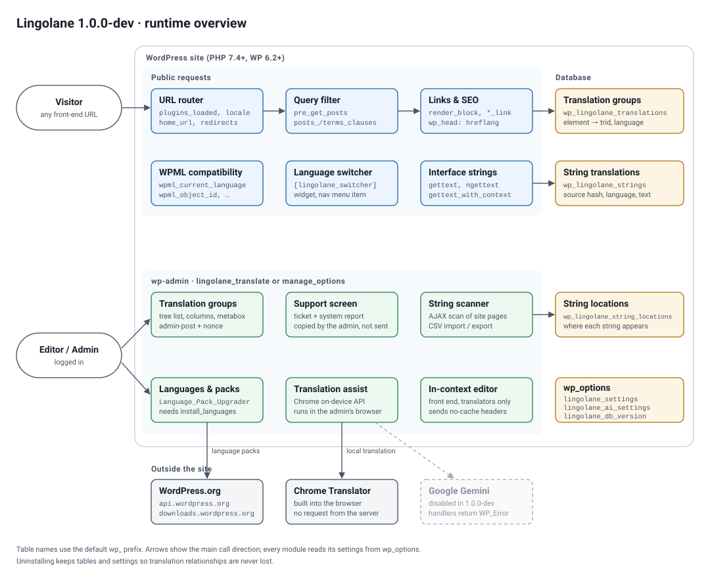

# Lingolane technical overview

Supporting notes for anyone reviewing the plugin code: what runs where, what is stored, which hooks and endpoints exist, and how each one is protected. It describes version 1.0.0-dev (PHP 7.4+, WordPress 6.2+).

Prepared by @tannguyen.



## 1. What the plugin does

Lingolane lets a site keep one post, page or term per language and link them into translation groups. It adds a language prefix to URLs (`/en/…`, with the default language unprefixed), filters queries to the current language, prints `hreflang` links, offers a language switcher, and lets translators override interface strings that come from the theme or other plugins.

## 2. Public requests

Classes in `lingolane/includes/`, in the order they act on a front-end request:

| Step | Class | Main hooks | Notes |
|---|---|---|---|
| Detect language | `Lingolane_Router` | `plugins_loaded`, `locale`, `home_url`, `redirect_canonical`, `template_redirect` | Reads the language prefix and switches the locale. |
| Filter content | `Lingolane_Query` | `pre_get_posts`, `posts_clauses`, `terms_clauses` | Joins `wp_lingolane_translations` so lists show the current language only. |
| Rewrite links | `Lingolane_Links`, `Lingolane_Urls` | `post_link`, `page_link`, `post_type_link`, `render_block` | Internal links keep the current language. |
| SEO | `Lingolane_Seo` | `wp_head`, `language_attributes`, `get_canonical_url`, core sitemap filters | `hreflang` and `x-default` alternates; canonical and sitemap filters for core, Yoast SEO, AIOSEO and SEOPress when present. |
| Switcher | `Lingolane_Switcher` | `[lingolane_switcher]`, `widgets_init`, `wp_nav_menu_objects`, `register_block_type` | Shortcode, widget, menu item and block. Output is escaped. |
| Interface strings | `Lingolane_Strings` | `gettext`, `ngettext`, `gettext_with_context` | Looks up `wp_lingolane_strings`, cached per request. |
| Compatibility | `Lingolane_Wpml_Shim`, `Lingolane_Wpml_Config` | `wpml_current_language`, `wpml_object_id` and other `wpml_*` filters | Lets themes written for WPML read Lingolane data. |

## 3. Admin features

All screens live under the **Multilingual** menu. Translators need the `lingolane_translate` capability (added to the administrator role on activation) or `manage_options`.

- **Translation groups** (`admin/class-lingolane-tree.php`, `-columns.php`, `-metabox.php`): tree list of posts and pages per language, list-table columns and an editor metabox to create or link a translation.
- **Languages and packs** (`admin/class-lingolane-admin.php`, `includes/class-lingolane-packs.php`): add, edit and remove site languages; install WordPress.org language packs through core (`wp_download_language_pack()`, `Language_Pack_Upgrader`). Installing packs also requires `install_languages`.
- **String translation** (`admin/class-lingolane-strings-admin.php`, `-string-terms.php`, `-string-scan.php`): grouped string table with inline editing, term name translation, CSV import and export, and a scanner that loads the site's own pages in the admin's browser to record where each string appears.
- **In-context editor** (`includes/class-lingolane-incontext.php`): on the front end, translators can edit strings in place. The page sends no-cache headers while the editor is active, so edited output is never cached for visitors.
- **Translation assist** (`includes/class-lingolane-ai.php`, `-ai-post.php`, `assets/ai-translate.js`): suggests translations with the Chrome on-device Translator API, which runs inside the admin's browser.
- **Support** (`admin/class-lingolane-support.php`): helps the admin write a support ticket and builds a system report that the admin copies by hand. The plugin does not send it anywhere.

## 4. Data stored

Custom tables, created with `dbDelta()` in `includes/class-lingolane-install.php`. The schema version is kept in `lingolane_db_version`, and upgrades only add tables or columns.

| Table | Purpose | Main columns |
|---|---|---|
| `{prefix}lingolane_translations` | Translation groups | `element_type`, `element_id` (unique pair), `trid`, `language_code`, `source_language_code` |
| `{prefix}lingolane_strings` | String overrides | `domain`, `context`, `source_hash`, `source`, `language_code`, `translation`, `updated_at` |
| `{prefix}lingolane_string_locations` | Where a string was seen | `domain`, `source_hash`, `occurrence_hash`, `group_key`, `subgroup`, `provider`, `object_id`, `field`, `page_path`, `locator`, `supported` |

Options: `lingolane_settings` (languages, default language, URL and switcher settings), `lingolane_ai_settings` (assist settings), `lingolane_db_version`.

Uninstalling keeps the tables, options and capability on purpose, so translation relationships are not lost if the plugin is removed and installed again. `uninstall.php` documents this.

## 5. External services

| Service | When | What is sent |
|---|---|---|
| `api.wordpress.org`, `downloads.wordpress.org` | Admin opens the Languages screen or installs a pack | Locale codes and the WordPress version, through core's translation API. No site content. |
| Chrome Translator API | Admin clicks a suggestion button | Nothing leaves the browser. The API is built into Chrome and translates on the device. |
| Google Gemini | Never in 1.0.0-dev | The settings fields exist but the provider is disabled: `Lingolane_Ai::translate_text()` and the post translation handler in `Lingolane_Ai_Post` return a `WP_Error` straight away. The plugin contains no `wp_remote_*` calls. |

The plugin loads no remote fonts, scripts or images. Icons are inline SVG from Lucide (ISC licence, see `assets/LICENSE-lucide.txt`).

## 6. Security model

- No REST routes. No `wp_ajax_nopriv_*` or `admin_post_nopriv_*` actions; every endpoint needs a logged-in user.
- Every AJAX action checks a capability and a nonce with `check_ajax_referer()`. Every `admin_post_*` action checks a capability and `check_admin_referer()`. Settings handlers go through `Lingolane_Admin::guard()`, which requires `manage_options`.
- Input is sanitised on the way in and escaped on output; translated HTML goes through `wp_kses_post()`. Queries on the custom tables use `$wpdb->prepare()`.

AJAX actions (`admin-ajax.php`):

| Action | Capability | Nonce action |
|---|---|---|
| `lingolane_save_string`, `lingolane_save_identity`, `lingolane_save_term_translation` | `lingolane_translate` or `manage_options` | `lingolane_strings_ajax` or `lingolane_terms_ajax`; the screen's form nonce is also accepted |
| `lingolane_delete_string` | `manage_options` | `lingolane_strings_ajax` |
| `lingolane_scan_pages`, `lingolane_scan_start`, `lingolane_scan_accept`, `lingolane_scan_preview` | `lingolane_translate` or `manage_options` | `lingolane_scan_ajax` |
| `lingolane_incontext_save`, `lingolane_incontext_manifest` | `lingolane_translate` or `manage_options` | in-context editor nonce |
| `lingolane_ai_translate` | `lingolane_translate` or `manage_options` | assist nonce |
| `lingolane_ai_test_key` | `manage_options` | assist nonce |

Form actions (`admin-post.php`):

| Action | Capability |
|---|---|
| `lingolane_save_default_language`, `lingolane_save_settings`, `lingolane_save_full_settings`, `lingolane_add_language`, `lingolane_update_language`, `lingolane_delete_language`, `lingolane_flush_cache`, `lingolane_save_ai_settings` | `manage_options` |
| `lingolane_install_pack` | `manage_options` and `install_languages` |
| `lingolane_add_translation` | `edit_post` on the source and `create_posts` on the post type |
| `lingolane_ai_translate_post` | `edit_post` |
| `lingolane_strings`, `lingolane_save_identity`, `lingolane_save_term_translation`, `lingolane_scan_theme_strings` | `lingolane_translate` or `manage_options` |

## 7. File map

```
lingolane/
  lingolane.php   bootstrap, constants, class loading
  uninstall.php   keeps data (see section 4)
  readme.txt
  includes/       front-end and shared classes (router, query, links, seo, strings, switcher, packs, install, WPML shim)
  admin/          admin screens and their handlers
  assets/         admin and front-end CSS/JS, inline SVG icons
  languages/      lingolane.pot and the bundled Vietnamese .po/.mo
```

## 8. Building the zip

`bin/build.sh` checks that the plugin header, `LINGOLANE_VERSION` and the readme `Stable tag` agree, compiles `.mo` files, runs `php -l` on every PHP file, and zips `lingolane/` without `tests/` and `.DS_Store`, adding `LICENSE.txt`. The output is `dist/lingolane-<version>.zip`.

Tests run with PHPUnit and the WordPress test library; CI runs phpcs (WordPress Coding Standards) and `php -l` on supported PHP versions. See the README for local setup.
